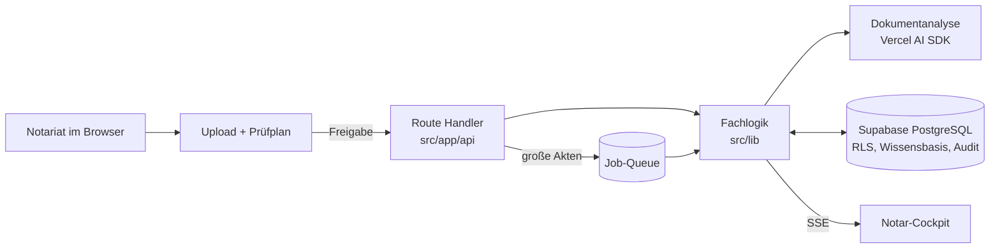

# Notar Agent


Ein Assistent für Notariate, der unstrukturierte Unterlagen zu **Immobilienkaufverträgen** prüft, ordnet und auf Lücken untersucht – und jede Angabe mit Datei, Seite und Originalzitat belegt.

> Tiefergehende Architektur, Safety-Hooks und Quality Gates: [docs/overview.md](docs/overview.md)

---

## 🚀 Live-Demo

**[notar-agent.vercel.app](https://notar-agent.vercel.app)** – kein Konto nötig:

1. Auf der Login-Seite **„Demo-Kanzlei testen“** klicken (Anmeldung als Notar mit vollen Rechten über eine echte Supabase-Session).
2. **„Neuen Vorgang starten“**, eine Datei aus [test-akten/](test-akten/) hineinziehen, **„Unterlagen prüfen“** klicken.
3. Im Prüfplan **„Prüfung starten“** bestätigen. Das Ergebnis erscheint im Notar-Cockpit.

Der Einstieg ist bewusst leer (kein Seed), damit nichts von Altdaten ablenkt.

---

## ✨ Funktionsumfang

- **Dashboard:** alle Vorgänge mit Reifegrad (`In Prüfung`, `Entwurfsreif`), Suche und Löschen.
- **10 Pflichtfelder im Ampelsystem:** Verkäufer, Käufer, Grundbuch, Grundstücke, Kaufpreis, Finanzierung, Belastungen, Mietverhältnisse, Energieausweis, Übergabe – je `Belegt`, `Prüfung nötig`, `Veraltet` oder `Fehlt`.
- **Belege statt Behauptungen:** jede Angabe mit Dateiquelle, Seite und Zitat; Abweichungen und Kaufpreis-Historie werden sichtbar.
- **Prüfplan vor dem Lauf:** zeigt vorab, was geprüft wird, und startet erst nach Freigabe.
- **Nachreichen (Delta-Modus):** fehlende Unterlagen ergänzen, ohne bereits belegte Felder zu verlieren.
- **Mensch im Loop:** Übersteuern mit dokumentiertem Grund, vorformulierte Nachforderungen mit 1-Klick-Kopie.
- **Export:** formatierter Prüfbericht für Kanzleisoftware (z. B. TriNotar, NoRA) und vollständiger JSON-Export.

---

## 🏗 Tech-Stack

| Bereich       | Technik                                                                              |
| ------------- | ------------------------------------------------------------------------------------ |
| Frontend      | Next.js 16 (App Router, Turbopack), React 19, Tailwind CSS, Radix UI, TanStack Query |
| KI            | Vercel AI SDK mit Anthropic und Google, SSE-Streaming über `/api/analyze`            |
| Daten         | Supabase PostgreSQL 17, Row-Level Security, `pgvector`                               |
| Warteschlange | PostgreSQL-Job-Queue (`dossier_jobs`, `SKIP LOCKED`) für Großakten                   |
| Qualität      | Vitest, Playwright, Promptfoo, Dependency Cruiser, Knip, jscpd, Husky, Semgrep       |

---

## 🧭 Architektur



Daten fließen in eine Richtung: `types` → `lib` → `app/api` → `components`. Route Handler parsen, authentifizieren und delegieren; Fachregeln liegen als Daten in der Datenbank, nicht im Code.

```text
src/
├── types/        Verträge: Zod-Schemas und Typen, keine Logik
├── lib/          Fachlogik: dossier, knowledge, audit, jobs, export, workflow, ai
├── app/api/      dünne I/O-Adapter (analyze, jobs, documents, auth, team, …)
├── components/   UI-Primitives (ui/), Cockpit, Dokumenttabelle
└── hooks/        Client-State über TanStack Query
supabase/migrations/   drei Domänen: core, knowledge, workflows
test-akten/            synthetische Referenzakten
docs/                  Architektur-Spezifikationen
```

---

## 🧠 Entscheidungen

- **Rechtsregeln sind Daten.** Fristen, Kriterien und Normen stehen in `knowledge_documents` (PostgreSQL), nie als Konstanten im Code. Prompts beschreiben nur den Ablauf.
- **PostgreSQL ist die einzige Wahrheit.** Repositories werfen bei Fehlern, es gibt keine stillen Fallbacks.
- **Filtern passiert in der Datenbank.** Keine ganzen Tabellen im Node-Speicher.
- **Nachvollziehbarkeit nach § 17 BeurkG.** Übersteuerungen und Exporte landen in einem Append-only-Audit-Trail mit SHA-256-Hash-Kette, inklusive Prüfgrundlage je Lauf.
- **Identität nur serverseitig** aus der validierten Session, nie vom Client.

Die vollständigen Regeln stehen in [AGENTS.md](AGENTS.md).

---

## ✅ Qualitätssicherung

| Befehl                                     | Prüft                                                                             |
| ------------------------------------------ | --------------------------------------------------------------------------------- |
| `npm run check`                            | Typen, Lint, Dependency Cruiser, Knip, Magic Strings, Duplikate, Repo-Health ≥ 90 |
| `npm test`                                 | Vitest-Unit- und Integrationstests                                                |
| `npm run eval:smoke` / `npm run eval:live` | Promptfoo gegen die Testakten                                                     |

Pre-Commit- und Pre-Push-Hooks (Husky, Semgrep) laufen automatisch und werden nie umgangen.

---

## 🧪 Testakten

[test-akten/](test-akten/) enthält 10 synthetische, datenschutzkonforme Akten mit realistischen Stolperfallen. Empfohlene Fälle:

| Fall                           | Datei                                                                                                             | Erwartetes Ergebnis                        |
| ------------------------------ | ----------------------------------------------------------------------------------------------------------------- | ------------------------------------------ |
| Standardfall                   | [Kaufvertrag_Koeln_UR89.pdf](test-akten/fall-04-standard-urkunde/Kaufvertrag_Koeln_UR89.pdf)                      | `READY`, alle 10 Felder `VERIFIED`         |
| Handschriftliche Randkorrektur | [Kaufvertrag_Scan.png](test-akten/fall-03-vertragsaenderung-handschrift/Kaufvertrag_Scan.png)                     | Kaufpreis `425.000,00 EUR`, `NEEDS_REVIEW` |
| Abgelaufener Energieausweis    | [Energieausweis_AachenerStr.pdf](test-akten/fall-06-energieausweis-prueffrist/Energieausweis_AachenerStr.pdf)     | `NEEDS_REVIEW`, „gültig bis 10.02.2023“    |
| Fehlende Grundbuchseite        | [Grundbuchauszug_Lindenthal.png](test-akten/fall-02-grundbuch-vollstaendigkeit/Grundbuchauszug_Lindenthal.png)    | `NEEDS_REVIEW`, Eigentümerdaten fehlen     |
| Mieterliste mit Handschrift    | [Mieterliste_Objekt_Lindenthal.pdf](test-akten/fall-08-mieterliste-handschrift/Mieterliste_Objekt_Lindenthal.pdf) | 30 Parteien, Jahresmiete `229.500,00 EUR`  |

---

## 💻 Lokal ausführen

**Voraussetzungen:** Node.js ≥ 22, npm, Docker Desktop (lokale Supabase).

```bash
git clone <repository-url>
cd notar-agent
npm install
cp .env.example .env.local
npm run db:start
npm run dev
```

Die App läuft unter [http://localhost:3000](http://localhost:3000), Supabase Studio unter [http://localhost:54323](http://localhost:54323).

In `.env.local` mindestens setzen:

```env
ANTHROPIC_API_KEY="sk-ant-..."   # oder GOOGLE_GENERATIVE_AI_API_KEY
AI_MODEL="claude-haiku-5-5"
NEXT_SUPABASE_URL="http://127.0.0.1:54321"
NEXT_SUPABASE_PUBLISHABLE_KEY="<lokaler-anon-key>"
```

Weitere DB-Befehle: `npm run db:reset` (Migrationen frisch anwenden), `npm run db:status`, `npm run db:lint`, `npm run db:stop`.

---

## 🗺 Weiterführend

- [ROADMAP.md](ROADMAP.md) – offene Aufgaben
- [BACKLOG.md](BACKLOG.md) – bewusst nicht gebaute Ideen
- [CHANGELOG.md](CHANGELOG.md) – abgeschlossene Meilensteine
- [docs/overview.md](docs/overview.md) – Architektur im Detail
