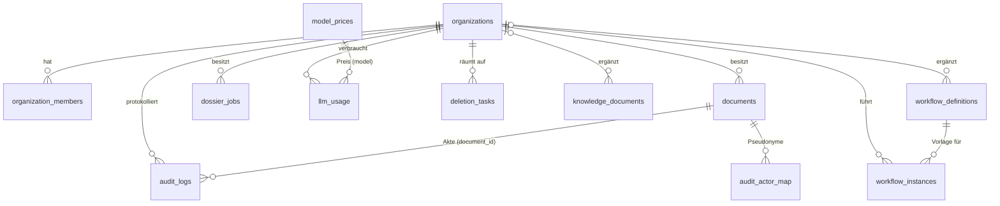

---
covers:
  - supabase/migrations/
---

# Datenmodell

> **Zweck:** Welche Tabellen es gibt, wie sie zusammenhängen und wo die Mandantentrennung greift. Maßgeblich sind die drei Domänenmigrationen in `supabase/migrations/` ([ADR 0002](../adr/0002-konsolidierte-domaenenmigrationen.md)); dieses Dokument fasst sie zusammen und ersetzt sie nicht. Die RLS-Regeln im Einzelnen: [multi-tenancy-compliance.md](multi-tenancy-compliance.md). Stand: 21.11.2026.

## 1. Überblick

`document_id` und `case_id` sind Textschlüssel ohne Fremdschlüssel auf `documents`: Prüfpfad und Löschauftrag müssen die Akte überdauern.

## 2. Tabellen nach Domäne

### Kern (`20260915000000_core_multi_tenancy.sql`)

| Tabelle                | Inhalt                                              | Besonderheit                                                                                  |
| :--------------------- | :-------------------------------------------------- | :-------------------------------------------------------------------------------------------- |
| `organizations`        | Kanzleien (Mandanten)                               | Wurzel der Mandantentrennung                                                                  |
| `organization_members` | Mitgliedschaft und Rolle je Nutzer                  | Trigger `organization_members_guard` schützt Rollenwechsel und den letzten Notar              |
| `profiles`             | Anzeigedaten je Nutzer (`auth.users`)               | Anlage per Trigger bei der Registrierung                                                      |
| `documents`            | Akten mit Status und Ergebnis (`content` als JSONB) | `retention_anchor_at` startet die Aufbewahrungsfrist; Trigger `documents_guard_review`        |
| `audit_logs`           | Prüfpfad je Akte                                    | Nur Einfügen; Hash-Kette per Trigger ([ADR 0005](../adr/0005-hash-kette-in-der-datenbank.md)) |
| `audit_actor_map`      | Pseudonym je (Akte, Nutzer)                         | Die Kette enthält nur `actor_ref`; Löschen der Zuordnung entfernt den Personenbezug           |

### Wissen (`20260916000000_knowledge_and_vector.sql`)

| Tabelle               | Inhalt                                                | Besonderheit                                                                      |
| :-------------------- | :---------------------------------------------------- | :-------------------------------------------------------------------------------- |
| `knowledge_documents` | Fachregeln als Daten, mit Einbettung (`vector(1536)`) | `organization_id` leer = allgemeine Regel; Suche über `match_knowledge_documents` |

### Abläufe (`20260921000000_jobs_and_workflows.sql`)

| Tabelle                | Inhalt                                             | Besonderheit                                                                                            |
| :--------------------- | :------------------------------------------------- | :------------------------------------------------------------------------------------------------------ |
| `dossier_jobs`         | Hintergrund-Analysen (Status, Prüfpunkt, Ergebnis) | Textschlüssel ist zugleich der Wiederholungsschutz ([ADR 0006](../adr/0006-idempotenz-ueber-job-id.md)) |
| `workflow_definitions` | Versionierte Ablaufpläne je Falltyp                | `organization_id` leer = Standardvorlage des Systems                                                    |
| `workflow_instances`   | Ablauf einer Akte                                  | Eindeutig je (`case_id`, `organization_id`)                                                             |
| `deletion_tasks`       | Auftragsausgang für Dateien im Speicher            | Status `PENDING`, `DONE`, `FAILED`; Wiederholung mit Zähler                                             |
| `llm_usage`            | Tokens je Modellaufruf und Stufe                   | Nur Lesen und Einfügen                                                                                  |
| `model_prices`         | Preise je Million Token                            | Daten statt Code; ohne Eintrag bleibt der Betrag leer                                                   |
| `llm_usage_costs`      | Sicht: Verbrauch mit Kosten                        | `security_invoker`, RLS der Basistabelle gilt                                                           |

## 3. Querschnitt

- **Mandantentrennung:** Alle Tabellen mit `organization_id` haben RLS. Die Zugehörigkeit prüft `is_org_member(organization_id)`; der Server leitet die Kanzlei aus der geprüften Sitzung ab, nie aus dem Request.
- **Löschverhalten:** `ON DELETE CASCADE` von `organizations` auf die Arbeitsdaten; `audit_logs` verwendet `RESTRICT`, damit der Prüfpfad nicht mit der Kanzlei verschwindet.
- **Rechnen in der Datenbank:** Kontingente (`dossier_jobs`, `llm_usage`), Listen und Löschläufe laufen als Sichten und Funktionen in PostgreSQL, nicht im Anwendungsspeicher.
- **Speicher:** Dateien liegen im privaten Bucket `dossier-files` mit Kanzleipräfix im Pfad; `dossier_jobs.payload` enthält nur Pfade.
