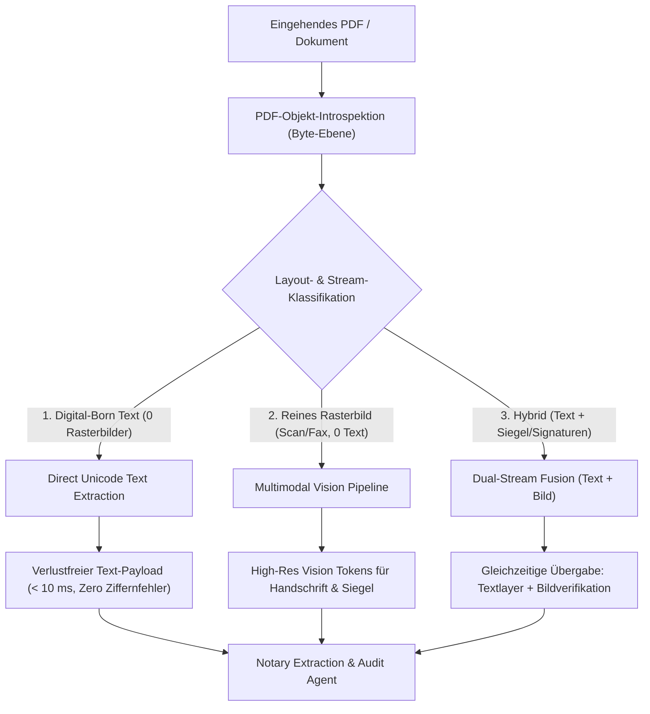

# Dual-Stream Ingestion Pipeline

> **Architektur-Spezifikation:** Verlustfreie Zeichenintegrität & Multimodal Vision  
> **Kernkomponenten:** `src/lib/files/pdf-stream-classifier.ts`, `src/lib/files/pdf-document-parser.ts`, `src/lib/ai/pipeline.ts`

---

## 1. Problemstellung im Notariat

Im Notariat steht **absolute Zeichenpräzision (Zero OCR-Tippfehler)** an oberster Stelle:

- Fehlerhafte Ziffernfolgen bei Kaufpreisen (`1.250.000 €`), Registernummern (`HRB 20459`) oder Flurstücken (`Flur 12, Flurstück 108/4`) führen zu verheerenden Zwischenverfügungen oder Haftungsfällen.
- Gleichzeitig enthalten notarielle Urkundensätze handschriftliche Vermerke, farbige Siegel, Stempel und unvollständige Scans, die reine Text-Parser nicht erfassen können.

---

## 2. Die 3 Stream-Klassen

Eine Byte-Ebene-Introspektion des PDFs klassifiziert jede eingehende Datei deterministisch in einen von drei Modi:

1. **Digital-Born PDF (Reiner Textlayer, keine Rasterbilder):**
   - Extrahiert den Text über Google Gemini Vision (`gemini-3.1-flash-lite`) bzw. im Offline-Fallback nativ via Deflate/Zlib-Streamextraktion (`< 20 ms`).
   - Geometrische Bounding-Box-Korrelation für Formularfelder, Annotationen und Skalen-Zeiger.
   - Keine visuellen Tokens nötig: 100 % Token- und Kostenersparnis.

2. **Scans / Bildträger (Reine Bildseiten, kein nutzbarer Text):**
   - Natives multimodales Ingestieren des PDFs direkt über Gemini Vision (`gemini-3.1-flash-lite`).
   - Übergabe der gerenderten PNG-Seiten direkt als Multimodal-Vision-Part (`image/png`) an das LLM.
   - Maximales Kontextverständnis bei Handschriften, Notarsiegeln und Stempeln ohne fehleranfälliges lokales Tesseract-OCR.

3. **Hybride Dokumente (Digitaler Text + eingescannte Siegel/Signaturen):**
   - **Dual-Stream Fusion mit Objekt-Extraktion:** Multimodale Transkription mit Gemini Vision kombiniert mit gezielter Bildausschnitts-Extraktion für Siegel und Stempel.
   - Jedes Bildobjekt (Siegel, Stempel, Beglaubigungsvermerk) wird mit exakter räumlicher Bounding-Box (`[x, y, width, height]`), Format und Auflösung an das LLM übergeben.
   - Im Textlayer verweist ein Manifest auf die exakte Position: Das LLM prüft den Text digital und verifiziert Siegel/Stempel visuell am genauen Fundort.

4. **Reine Bilddateien (JPG, PNG, WebP):**
   - Werden direkt nativ als Bild-Payloads an das Vision-LLM übergeben.

5. **Office-Dokumente (.docx / Word-Kaufvertragsentwürfe):**
   - Konvertierung direkt im In-Memory-Stream via `mammoth` ([`src/lib/files/docx-document-parser.ts`](../../src/lib/files/docx-document-parser.ts)) in strukturiertes Markdown.
   - **Semantische juristische Format-Maps:** Paragraphen, Klauseln, Rubren und Belehrungen werden über deklarative Style-Mappings direkt in saubere Markdown-Hierarchien überführt.
   - **Eingebettete Bildextraktion:** In Word eingebettete Siegel, Stempel, Unterschriften oder Lagepläne werden isoliert extrahiert und als multimodale Bild-Parts an das Vision-LLM übergeben.
   - **Vorteil gegenüber schweren Office-Containern:** `mammoth` operiert auf dem fließenden OpenXML-Dokumentenmodell und verankert Bilder als Inline-Marker direkt an der exakten Stelle im Klausel-Fließtext, sodass das LLM den vollständigen semantischen Kontext (z. B. Siegel direkt unter dem Unterschriftsvermerk) ohne schwere LibreOffice-Container-Abhängigkeiten erhält.
   - 100 % serverless- und cloud-kompatibel.

---

## 3. Architektur-Status & Ausbaustufen

- **Deterministisches Zitat-Grounding via `diff-match-patch` (Implementiert):**
  Zeichengenaue Verifikation von Beleg-Snippets auf dem PDF-Textlayer zur Vermeidung von Halluzinationen (§ 17 BeurkG Provenance) mit exakter Koordinaten- und Offset-Lokalisierung.
- **Serverless Ingestion Overhaul (B.8):**
  Flache, modulare Zod-Sub-Schemas pro Dokumenttyp (Grundbuch, Energieausweis, Mietlisten) und selektives Windowing für Großakten (> 150 Seiten) bei 100 % Serverless-Kompatibilität.

---

## 4. Idempotente Ingestion & Kanonische Text-Normalisierung

Um redundante OCR-Aufrufe, Token-Kosten und Zitations-Offset-Drifts zu eliminieren, implementiert die Pipeline strikte Idempotenz:

1. **Deterministischer Ingestion-Fingerprint (`contentHash`):**
   - Jedes eingehende Dokument wird unmittelbar bei Einreichung über seinen kryptografischen SHA-256 Hash erfasst (`calculateFileFingerprint`).
   - Identische Dokumente (z. B. bei Retries, doppelten Uploads oder Delta-Nachreichungen) werden dedupliziert.

2. **Kanonische Textnormalisierung (`toCanonicalText`):**
   - Garantiert mathematische Idempotenz: $f(f(x)) = f(x)$ (nachgewiesen via Property-Based Tests).
   - Bereinigt Steuerzeichen (BOM, Nullbytes), normalisiert Zeilenumbrüche (`\n`), Leerzeilen und Unicode (NFC für stabile deutsche Umlaute).
   - Repariert Markdown-Tabellentrennerzeilen, sodass LLM- und OCR-Tabellen stabil formatiert bleiben.
   - Hält Zeichen-Offsets für Diff-Matching und Beleg-Hervorhebung im Viewer konsistent.
