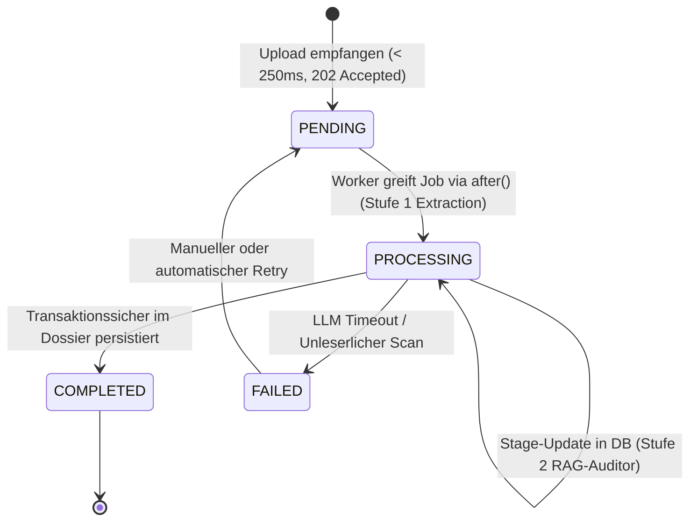
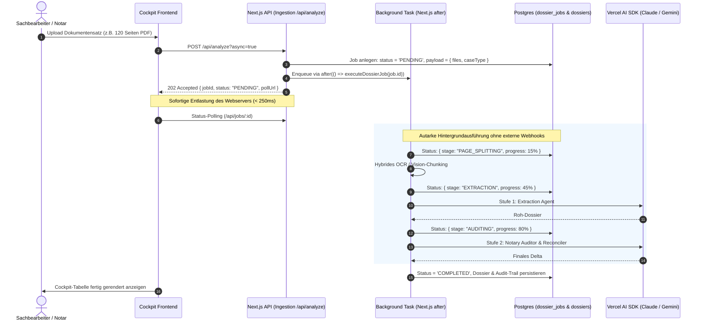

# Asynchrone Job-Orchestrierung

> **Architektur-Spezifikation:** Asynchrone Hintergrundverarbeitung im 24/7-Kanzleibetrieb  
> **Kernkomponenten:** `src/types/jobs.ts`, `src/lib/jobs/job-repository.ts`, `src/lib/jobs/job-worker.ts`, PostgreSQL `dossier_jobs`

---

## 1. Problemstellung im Kanzleialltag

| Problem                | Auswirkung ohne Queue (Synchron)                                                                  | Lösung mit PostgreSQL-Queue (`dossier_jobs`)                                           |
| :--------------------- | :------------------------------------------------------------------------------------------------ | :------------------------------------------------------------------------------------- |
| **HTTP-Timeouts**      | Proxies kappen Verbindungen nach 30–60 s. 100-Seiten-Lauf bricht mit `504 Gateway Timeout` ab.    | HTTP-Upload antwortet in **< 250 ms** mit `202 Accepted` (`status: PENDING`).          |
| **Tab-Schließung**     | Sachbearbeiter schließt den Browser $\rightarrow$ Lauf bricht ab, Tokens verbrannt.               | Jobs persistieren transaktionssicher in Postgres; Bearbeitung läuft entkoppelt weiter. |
| **Peak-Load & Limits** | Wenn morgens 8 Mitarbeiter gleichzeitig Akten hochladen, drohen `429 Rate Limits` oder RAM-Crash. | **Concurrency Control:** Worker greift Jobs via `FOR UPDATE SKIP LOCKED`.              |
| **Transiente Fehler**  | KI-Server überlastet (`529 Overloaded`) $\rightarrow$ Vorgang scheitert.                          | Automatischer Retry-Zähler im Job-Record mit geregeltem Backoff.                       |

---

## 2. Job-Lifecycle & Sequenz

---

## 3. Serverlose Event-Orchestrierung & Autarke Ausführung

### Entkoppelte Ausführung via Next.js `after()`

Für Uploads und Analysen aus der Web-Applikation (`POST /api/analyze?async=true`) wird der Hintergrund-Worker direkt im Serverless-Lifecycle verankert:

- **Sofortige Antwort:** Der Client erhält binnen < 250 ms ein `202 Accepted` mit `jobId`.
- **Runtime-Garantie:** Über `after(() => executeDossierJob(job.id))` garantiert die Next.js-Laufzeit auf Vercel, dass die Lambda-Funktion bis zum Abschluss der Analyse aktiv bleibt, ohne auf externe HTTP-Aufrufe angewiesen zu sein.
- **Lokale Autarkie & Zero-Config:** Funktioniert lokal in `npm run dev` sowie in Produktion ohne Ngrok, externe Tunnel, Webhook-Pings oder zusätzliche `SUPABASE_WEBHOOK_SECRET`-Keys.
- **Lease Timeout & Orphan Sweeper:** Bricht ein Serverless-Container unerwartet ab, identifiziert die Abfrage verwaiste Jobs anhand von `lease_timeout_at` und ermöglicht automatische Retries.
